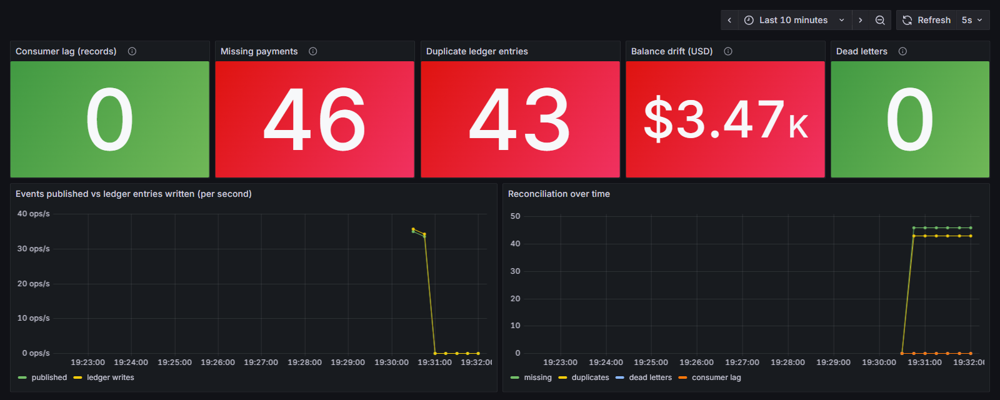
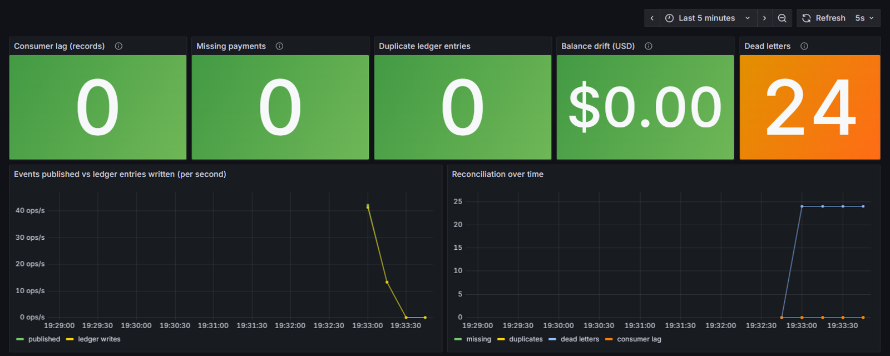

# Kafka silent failures

**Pipelines don't fail with a stack trace. They fail quietly.**

This repo is a small payments pipeline (Java 25, Spring Boot 4, Kafka, Postgres). It shows three common ways an event pipeline loses or duplicates data **without crashing**, how to fix each one, and how to build a check that makes the problem visible.



The picture above is the main idea. Consumer lag is **0** and every service is up. Most dashboards would say "healthy". But 46 payments never reached the ledger, 43 were booked twice, and the ledger is off by $3,466.49.

## The three failures

The app runs in two modes. `naive` is the code many teams write first. `safe` is the fixed version. Both run the same fault injection, so you can compare them.

| # | Failure | Naive mode | Safe mode |
|---|---------|------------|-----------|
| 1 | **Dual write.** The service saves the payment, then sends the event. The send fails. | Error is logged, the event is never sent. The payment exists, but the ledger never hears about it. | **Transactional outbox.** The payment and the event are saved in one DB transaction. A relay sends the event and retries until Kafka confirms it. |
| 2 | **Redelivery.** The consumer writes to the DB, then dies before Kafka commits the offset. | Kafka sends the message again, and the payment is booked twice. | **Idempotent consumer.** A `processed_events` row is written in the same transaction as the ledger entry. A second delivery finds it and does nothing. |
| 3 | **Poison message.** A message that can never be parsed. | Caught, logged, offset committed. The payment is gone. | Not retried (it would never work), sent to a **dead-letter topic**, and saved with its event id. It is visible and can be replayed. |

## Results

1,000 payments, seed 42, with these faults: 3% failed sends, 5% consumer crashes after the write, 2% poison messages. The numbers come from the integration tests (`./mvnw verify`) and from `scripts/run-scenario.sh`. Both give the same result, because the faults are chosen by a hash of the event id.

| | Naive | Safe |
|---|---|---|
| Payments | 1,000 | 1,000 |
| Missing (lost with no trace) | **46** | **0** |
| Duplicate ledger entries | **43** | **0** |
| Balance drift | **+$3,466.49** | **$0.00** |
| Dead letters (visible, can be replayed) | 0 | 24 |
| Consumer lag at the end | 0 | 0 |
| Alerts firing | 3 critical | 1 warning (dead letters) |



## How the detection works

Consumer lag only tells you that messages are **waiting**. It cannot tell you that a message was never sent, or was skipped, or was applied twice.

So the `Reconciler` compares the **source of truth** (the `payments` table) with the **result** (the `ledger_entries` table) every 5 seconds:

- **missing**: payments with no ledger entry and no dead letter
- **duplicates**: extra ledger entries for the same event
- **dead letters**: payments parked in the dead-letter table
- **balance drift**: ledger total minus the expected total

It only checks payments older than a grace period (10 s), so events that are still in flight are not reported as missing. The numbers go to Prometheus as gauges, and `ops/prometheus/alerts.yml` turns them into alerts.

**Why not just check the balance?** Look at the naive result. The drift is **positive** (+$3,466.49): the ledger has *more* money than expected. If you only checked the total, you would think nothing was lost. But 46 payments were lost. The duplicates simply hid them. That is why the reconciler counts missing and duplicate entries one by one.

## Run it

You need Docker. Java 25 is only needed to run the tests outside Docker.

```bash
scripts/run-scenario.sh naive     # or: safe
```

Then open:

- Grafana: http://localhost:3001 (no login)
- Prometheus alerts: http://localhost:9090/alerts
- Reconciliation report: http://localhost:8080/reconciliation

You can also send your own payments:

```bash
curl -X POST localhost:8080/payments -H 'Content-Type: application/json' \
     -d '{"accountId":"acc-1","amountCents":1250}'
curl -X POST 'localhost:8080/simulate?count=1000&accounts=50&seed=42'
```

Fault rates are environment variables: `FAULT_PRODUCER_SEND`, `FAULT_CONSUMER_CRASH`, `FAULT_POISON` (percent).

## Tests

```bash
./mvnw test      # unit tests, no Docker
./mvnw verify    # + integration tests with real Kafka and Postgres (Testcontainers)
```

The integration tests do not trust the pipeline to grade itself. `ScenarioExpectations` calculates the expected counts **only from the fault rules**, without Kafka or the database. The test then waits until the real pipeline reaches exactly those numbers. If a change makes the safe mode lose one payment, or makes the naive mode stop showing a bug, the test fails.

There are also tests for the edge cases:

- a poison message that is not even JSON is still linked to its payment (through the `event-id` Kafka header, not the payload)
- payments that are still in flight are not reported as missing

## Design notes

**Why not Kafka transactions (exactly-once)?** They make the read-process-write loop atomic *inside Kafka*. Here the write goes to Postgres, and Kafka transactions do not cover it. The outbox and the idempotent consumer cover both sides with plain database transactions.

**The outbox relay can send an event twice.** If the app dies after Kafka confirms the send but before the row is marked as sent, the event goes out again. That is fine, because the consumer is idempotent. Each fix depends on the other one.

**Why one Spring app for both sides?** To keep the demo to one container. The payments side and the ledger side only share the Kafka topic. They use different tables, and nothing else is shared.

**Fault injection is deterministic.** `FaultInjector` hashes the fault name and the event id (MD5, not for security, just to spread the values). The same seed always breaks the same events, so a bug can be reproduced.

**Spring Boot 3 → 4: what changed in this project**

- Jackson 3: the package is `tools.jackson`, the mapper is `JsonMapper`, and `JacksonException` is unchecked.
- Modular starters: `spring-boot-starter-webmvc`, `spring-boot-starter-kafka`, `spring-boot-starter-flyway` instead of the old general ones.
- Testcontainers 2: modules are `testcontainers-kafka` / `testcontainers-postgresql`, and the classes moved to `org.testcontainers.kafka` / `org.testcontainers.postgresql`.

## How I built it

The design is in `docs/specs/` and the step-by-step plan is in `docs/plans/`. Both were committed before the code, and each step started with a failing test. You can follow this in the git history.

I work with Claude Code every day. `CLAUDE.md` has the rules I give it for this repo. `.claude/hooks/guard.mjs` is a guardrail that blocks edits to committed Flyway migrations, force pushes and `--no-verify`. The guardrail has its own tests, and CI runs them.

## Project layout

```
src/main/java/dev/paulguevara/silentfailures/
  payments/        upstream service: PaymentService (naive dual write / safe outbox), OutboxRelay
  ledger/          downstream consumer: LedgerListener, DeadLetterListener
  reconciliation/  Reconciler, ReconciliationReport
  faults/          FaultInjector
  config/          modes, fault rates, Kafka error handling per mode
ops/               Prometheus config and alerts, Grafana dashboard
scripts/           run-scenario.sh
```
